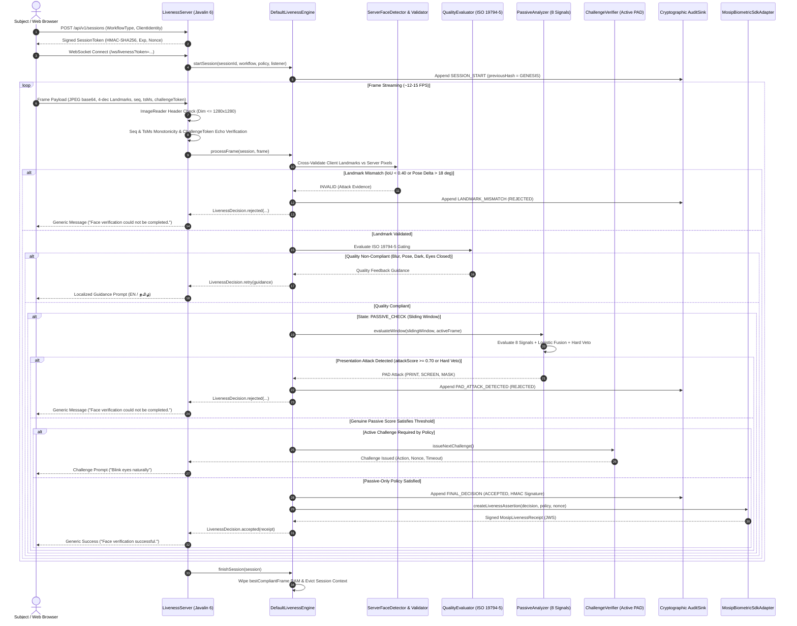

# System Architecture & Technical Specification

**Project:** MOSIP Face Liveness & Presentation Attack Detection (PAD)  
**Language:** Java 17 (Pure Java Core, Zero External Heavy Runtime Dependencies)  
**Standards:** ISO/IEC 19794-5, ISO/IEC 30107-1/-3, RFC 7515 (JWS)  

---

## 1. Modular Architecture

```
                                  +-----------------------+
                                  |     liveness-api      |  (Pure Java 17 Interfaces, Records & Enums)
                                  +-----------------------+
                                        ^           ^
                    +-------------------+           +-------------------+
                    |                                                   |
          +-------------------+                               +-------------------+
          |   liveness-core   | (Quality, Passive PAD,        | liveness-device-  |
          |                   |  Challenges, Audit Chain,     |      mock         |
          |                   |  JWS Receipts, Verifier CLI)  |                   |
          +-------------------+                               +-------------------+
             ^             ^                                            ^
             |             |                                            |
    +-----------------+    |                                            |
    |  liveness-onnx  |    |                                            |
    | (Optional Ultra-|    |                                            |
    |  Face, MiniFAS) |    |                                            |
    +-----------------+    |                                            |
             ^             |                                            |
             |             |                                            |
             +-------------+-----------------------+                    |
                           |                       |                    |
                 +-------------------+   +-------------------+          |
                 |  liveness-server  |   |   liveness-eval   |----------+
                 | (Javalin 6 WS/REST|   | (ISO 30107-3 CLI  |
                 |  Webcam Client)   |   |  Benchmark Suite) |
                 +-------------------+   +-------------------+
```

---

## 2. End-to-End Verification Lifecycle



---

## 3. Core Architectural Modules

### `liveness-api` (Contract Layer)
- Pure Java 17 records, interfaces, and enums.
- Zero dependencies on external libraries or frameworks.
- Defines `LivenessEngine`, `LivenessSession`, `FaceFrame`, `FaceQuality`, `LivenessDecision`, `LivenessPolicy`, `LivenessAuditEvent`.

### `liveness-core` (Inference & Security Layer)
- **`ServerFaceDetector` & `LandmarkCrossValidator`:** Eliminates client spoofing by executing independent Haar/pixel skin detection on the server and comparing bounding box IoU ($\ge 0.40$), pupil distance ($\le 0.20$), and 3D pose deltas ($\le 18^\circ$).
- **`QualityEvaluator`:** Implements ISO/IEC 19794-5 face quality checks: face size ratio ($0.08$ to $0.75$), pose tolerances ($\le 15^\circ$), luma ($0.20$ to $0.85$), and sharpness (Laplacian variance $\ge 35.0$).
- **`PassiveAnalyzer`:** Evaluates 8 independent presentation attack signals:
  1. *Micro-Motion:* Procrustes non-rigid physiological landmark jitter residual.
  2. *Moire Frequency:* 2D Fast Fourier Transform (FFT) subpixel grid frequency analysis.
  3. *Specular Glare:* Highlight intensity ratio over face ROI.
  4. *Texture / Color:* RGB standard deviation and HSV color saturation statistics.
  5. *Border / Bezel:* Orthogonal Hough / Radon line accumulator over outer frame margins.
  6. *Timing Integrity:* Inter-frame variance, microsecond burst anomalies, and sequence gaps.
  7. *Landmark Consistency:* Pixel color corroboration at landmark locations.
  8. *3D Mask Detection:* Micro-pore texture variance and contour gradient transitions.
- **`LogisticFusionModel`:** Calibrated logistic regression fusing all 8 heuristic signals with deterministic hard-veto rules (e.g. $\ge 2$ screen cues below $0.20$ triggers instant veto).
- **`MosipLivenessReceipt` & `MosipBiometricSdkAdapter`:** Signs and verifies compact RFC 7515 JWS receipt tokens for MOSIP Registration Client / IDA consumption.
- **`AuditVerifierCli`:** Standalone CLI tool that scans `audit.jsonl` files and cryptographically verifies the SHA-256 forward hash chain, genesis linkage, canonical JSON details, and terminal HMAC-SHA256 signatures.

### `liveness-onnx` (Optional Neural Module)
- Deep learning inference models loaded when ONNX Runtime is available:
  - **UltraFace RFB-320:** Real-time face detection ($< 10\text{ ms}$).
  - **MiniFASNetV2:** Multi-scale patch passive presentation attack detection.
  - **MobileFaceNet:** 512-dimensional face embeddings for cosine similarity verification across frames.
- Degrades gracefully to the pure-Java heuristic pipeline if ONNX models are absent.

### `liveness-server` (Application & UI Layer)
- Embedded Javalin 6 server providing WebSocket streaming and REST APIs.
- Token-gated endpoints: `/api/audit*`, `/api/policy*`, and `/api/supervisor/override` require `LIVENESS_ADMIN_TOKEN`.
- Embedded HTML5 client with Judge Mode, Live Telemetry Radar, Voice Guidance (Tamil & English), High-Contrast Mode, and Red Team Attack Gallery simulator.
